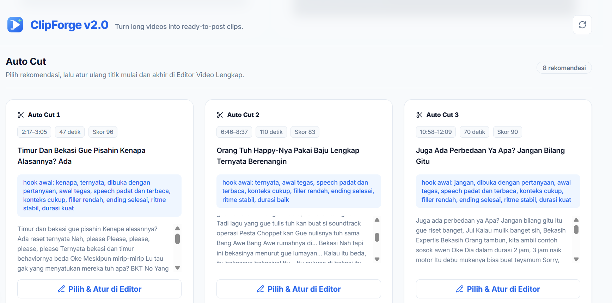
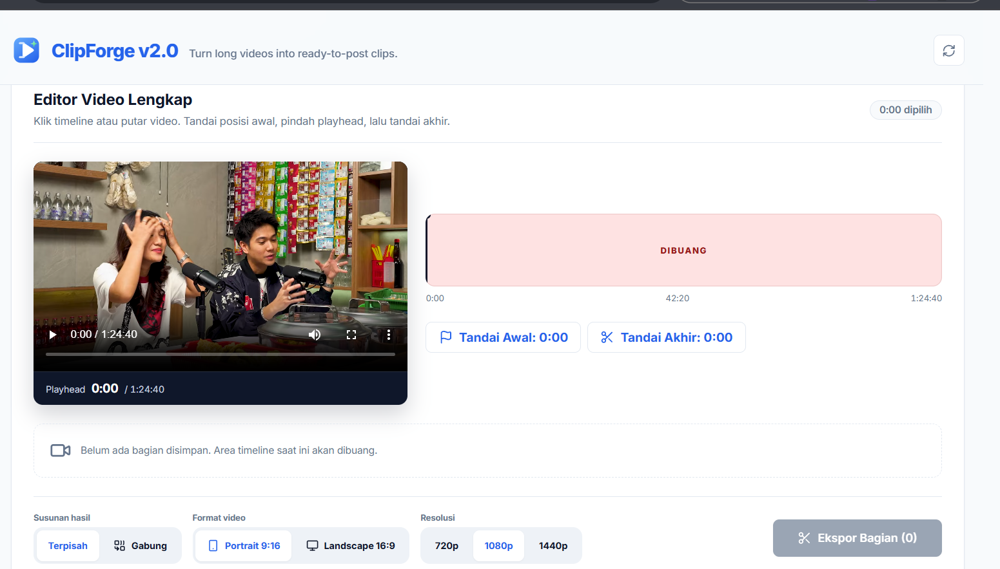
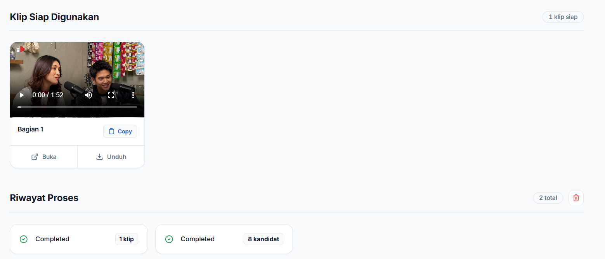

# ClipForge

Local-first tool for reviewing long YouTube videos, selecting useful ranges, and exporting ready-to-post clips with local transcription and smart crop options.

## Overview





## Features

- Download a single YouTube video with `yt-dlp`, including an HLS fallback for HTTP 403 responses.
- Transcribe locally with `faster-whisper`.
- Score transcript windows for clip candidates.
- Preview the full source video and mark multiple custom ranges before rendering.
- Export separate clips or combine selected ranges into one video.
- Export portrait 9:16 or landscape 16:9 MP4 at 720p, 1080p, or 1440p.
- Burn subtitles into clips by default.
- Crop center or shift crop toward detected faces/people.
- Keep Auto Cut candidates available after a manual export.
- Manage, preview, download, and delete jobs from a Next.js UI.
- Run locally with Python/Node or with Docker Compose.

## Requirements

- Python 3.12+
- Node.js 22+
- npm
- FFmpeg and FFprobe available on `PATH`
- Network access for YouTube downloads and model downloads
- Enough CPU, disk, and time for transcription and video encoding

Docker users only need Docker and Docker Compose.

## Quick Start With Docker

Copy the Docker env example:

```powershell
Copy-Item .env.docker.example .env
```

For local Docker usage, defaults are enough:

```env
FRONTEND_PORT=3000
BACKEND_PORT=8010
NEXT_PUBLIC_API_BASE=http://localhost:8010
```

Build and run:

```powershell
docker compose --env-file .env up -d --build
```

Open:

```text
frontend: http://localhost:3000
backend:  http://localhost:8010
```

Persistent local data:

```text
backend/outputs -> /app/outputs
backend/jobs.json -> /app/jobs.json
```

## Local Development

Start backend:

```powershell
cd backend
py -m venv .venv
.\.venv\Scripts\python.exe -m pip install -r requirements.txt
.\.venv\Scripts\python.exe -m uvicorn api:app --host 127.0.0.1 --port 8010
```

Start frontend in another terminal:

```powershell
cd frontend
npm install
npm run dev
```

Open `http://127.0.0.1:3000`.

## CLI Usage

The backend can also run without the UI:

```powershell
cd backend
.\.venv\Scripts\python.exe clipper.py "https://www.youtube.com/watch?v=..." --top 10 --min 35 --max 180
```

Quick test on the first 180 seconds:

```powershell
.\.venv\Scripts\python.exe clipper.py "https://www.youtube.com/watch?v=..." --model Systran/faster-whisper-base --analyze-seconds 180 --top 1
```

Outputs are written under `backend/outputs/`.

## API

```text
GET    /api/health
POST   /api/jobs
GET    /api/jobs
GET    /api/jobs/{job_id}
POST   /api/jobs/{job_id}/render
DELETE /api/jobs
GET    /outputs/<generated-file>
```

`POST /api/jobs` prepares metadata, source preview, transcript, and Auto Cut candidates. It does not render clips automatically. Send the chosen ranges to `POST /api/jobs/{job_id}/render` when review is complete.

## Processing Notes

- Long videos take time: download, audio extraction, transcription, scoring, and rendering run as background jobs.
- Existing complete source videos, metadata, transcripts, and candidates are reused when possible.
- If a YouTube CDN URL returns HTTP 403, the downloader retries once with a compatible fallback format.
- Video preview supports HTTP range requests. A working preview normally returns HTTP `206 Partial Content` while seeking.
- Deleting history is rejected while a job is queued or running. Wait for active work to finish first.
- On Windows, an output currently open by the browser may remain locked. History deletion still succeeds and reports that output as skipped; close or refresh the preview before cleaning it again.

## Configuration

For Docker/server deployments, `NEXT_PUBLIC_API_BASE` must be the browser-accessible backend URL:

```env
NEXT_PUBLIC_API_BASE=https://api.example.com
```

The frontend also uses `BACKEND_API_BASE` internally for proxying API requests in Docker:

```env
BACKEND_API_BASE=http://backend:8010
```

## Safety And Legal Notes

ClipForge is intended for local workflows and content you are allowed to process. Make sure you have rights or permission to download, transform, and republish source videos. Follow YouTube terms and applicable copyright law.

Do not expose the backend publicly without authentication, rate limits, request validation, quotas, and cleanup. The backend accepts URLs and runs expensive jobs.

## Project Structure

Android Flutter prototype: see [mobile/README.md](mobile/README.md). The mobile app runs YouTube download, Whisper transcription, Auto Cut recommendations, range editing, subtitles and clip rendering locally on ARM64 Android. Physical-device verification is documented separately from APK build verification.

```text
backend/
  api.py                 FastAPI job API
  clipper.py             download/transcribe/score/export pipeline
  models/                optional crop detection model
  outputs/               generated local files, ignored by git
frontend/
  app/                   Next.js app router UI
  lib/apiClient.ts       API client helpers
  types/clip.type.ts     shared frontend types
docker-compose.yml       local two-service stack
```

## License

MIT. See `LICENSE`.

Third-party notices live in `NOTICE`.

## Author

Created by [mallexibra](https://mallexibra.my.id/).
